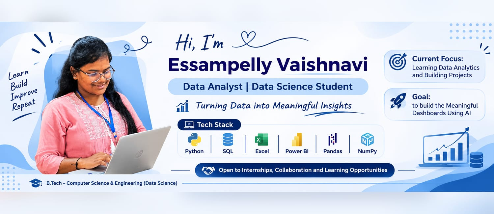

# Hi, I'm Vaishnavi! 👋

### Data Analyst | Data Science Student | Aspiring Data Scientist

I'm a B.Tech student specializing in Computer Science and Engineering (Data Science), passionate about transforming raw data into meaningful insights and building intelligent solutions.

I enjoy working with Python, SQL, Excel, Power BI, and machine learning to solve real-world problems through data analysis and visualization.

My goal is to develop strong analytical and technical skills while building practical projects in Data Science, Machine Learning, and Business Intelligence.

---

## 🛠️ Technical Skills

**Programming Languages**
- Python
- SQL

**Data Analysis & Visualization**
- Pandas
- NumPy
- Microsoft Excel
- Power BI
- Tableau
- Matplotlib
- Seaborn

**Machine Learning**
- Regression
- Classification
- Clustering
- Scikit-learn
- Decision Trees

**Tools & Technologies**
- Jupyter Notebook
- VS Code
- Git
- GitHub
- MySQL
- Django

---

## 📊 Featured Projects

**1. AI Impact on Jobs – Excel Dashboard**
- Developed an interactive Excel dashboard to analyze AI adoption, job automation risks, employee satisfaction, and future employment trends.
- Used Pivot Tables, Pivot Charts, KPIs, and slicers.

**2. Netflix Data Analysis Dashboard**
- Analyzed Netflix content data using Excel.
- Explored content distribution, ratings, genres, and trends through interactive visualizations.

**3. Sales Analysis Dashboard**
- Built an interactive sales dashboard using Excel.
- Analyzed sales performance, profitability, customer trends, and shipping metrics.
---

## 💼 Internship Experience

- AI Data Analyst Intern – InAmigos Foundation
- Data Analytics Intern – OASIS INFOBYTE
- Data Science Intern – PRODIGY INFOTECH
- Data Analytics Intern - UpToskills
- Gen AI & Cloud Computing Intern - BharathCares

---

## 🎓 Education

**B.Tech – Computer Science and Engineering (Data Science)**

---

## 📜 Certifications

- Data Analysis with Python – IBM
- Python for Data Science – IBM
- Data Analytics Job Simulation – Quantium
- Data Analytics Job Simulation – Deloitte
- AI Skills Passport – Microsoft & EY
- Git & GitHub - ExcelR
- Introduction to MS Excel - Simplilearn

---

## 🌱 Currently Learning

- Advanced SQL and Data Analytics
- Machine Learning
- Python for Data Science
- Power BI Dashboard Development
- Predictive Analytics

---

## 🤝 Connect With Me

- **GitHub:** [My GitHub Profile](https://github.com/vaishnaviessampelly24-gif)
- **LinkedIn:** [Connect with me](https://www.linkedin.com/in/essampelly-vaishnavi-5b025b370/)

---

⭐ *Learning, Building, Analyzing, and Growing Every Day!* 
